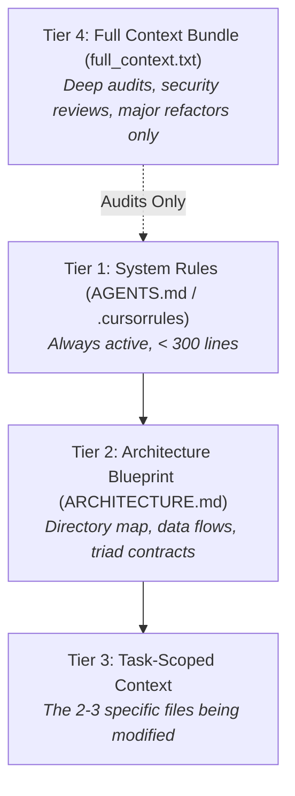

# Context Engineering for Vibe Coders

> **How to manage context, prevent token bloat, eliminate hallucination loops, and feed your codebase into AI coding agents without leaking secrets or losing architectural control.**

---

## 1. The Context Problem

In the early stages of a project (10–20 files), AI coding agents feel like magic. They remember everything, write clean code, and rarely hallucinate.

Once your project reaches **100+ files**, everything begins to degrade:
- The AI forgets how authentication is wired.
- It invents utility functions that already exist in `src/utils/`.
- It patches a file by rewriting it with a completely different coding style.
- It hits token limits and truncates output mid-function.

**This is Context Drift.** LLM reasoning degrades as context length increases. The key to successful vibe coding is not giving the AI *more* context — it is giving the AI the **exact right level of context**.

---

## 2. The 4-Tier Context Hierarchy

Instead of dumping your entire project into every prompt, organize your context into 4 distinct tiers:



### Tier 1: System Instructions (`AGENTS.md`, `.cursorrules`, `CLAUDE.md`)
- **Scope:** Permanent rules, conventions, and constraints.
- **Size:** Strictly under 250–300 lines.
- **Contents:** Tech stack, lint rules, touch hit area constraints ($\ge 44\text{px}$), test runner commands, and debugging laws (e.g. "Do not patch symptoms without identifying root cause").

### Tier 2: Architecture Blueprint (`ARCHITECTURE.md`)
- **Scope:** High-level project topology.
- **Size:** 100–200 lines.
- **Contents:** File naming conventions (e.g. The Theme Triad), database collection schema, and server route mappings. Feed this when onboarding an agent or planning a new module.

### Tier 3: Task-Scoped Context (The 3-File Rule)
- **Scope:** 90% of daily vibe coding tasks.
- **Rule:** Never feed more than **2 to 3 files** into an implementation prompt.
  - File 1: The file to be modified (e.g., `src/pages/PresentationEditor.tsx`).
  - File 2: The type definitions / interfaces (e.g., `src/types/slide.ts`).
  - File 3: The caller or consumer component (e.g., `src/App.tsx`).

### Tier 4: Full Project Context Bundle (`full_context.txt`)
- **Scope:** High-level security audits, full architecture reviews, or migrating to a new major framework.
- **Size:** Several megabytes (1M+ tokens).
- **Rule:** Only use with high-context models (Gemini 1.5/2.0 Pro). **MUST BE SANITIZED TO PREVENT SECRET LEAKS.**

---

## 3. Safe Context Bundling (Zero-Leak Protocol)

When you need an external LLM to review your entire repository, you must generate a single context file safely.

### The Dangers of Naive Bundling
If you run a basic script that concatenates all files in your folder, you will accidentally leak:
1. **`.env` and `.env.local`:** Raw API keys, database credentials, Stripe secrets.
2. **User Data:** Local test databases, `users.json`, email campaign exports.
3. **Massive Binaries:** `.pdf`, `.pptx`, `.zip`, `.mp4` that blow past token budgets and corrupt text decoders.
4. **Build Artifacts:** `dist/`, `build/`, `node_modules/` that waste millions of tokens on minified code.

---

## 4. Production Context Bundler Script

Here is the exact, battle-tested Node script from [PPT Maker](https://pptmaker.co.in) that safely bundles 800+ files into a clean `full_context.txt` with automated secret redaction.

Save this in your project as `scripts/bundle-context.cjs`:

```javascript
/**
 * scripts/bundle-context.cjs
 * 
 * Safely bundles a codebase into full_context.txt for LLM analysis.
 * Strictly excludes: .env, secrets, user data, binaries, and build artifacts.
 */

const fs = require('fs');
const path = require('path');

const rootDir = path.resolve(__dirname, '..');
const outputFile = path.join(rootDir, 'full_context.txt');

// 1. Directories to strictly skip
const SKIP_DIRS = new Set([
  'node_modules', '.git', '.vercel', '.vscode', '.idea',
  'dist', 'build', 'coverage', 'data', 'public', 'uploads',
  'scratch', 'android', 'temp', 'tmp'
]);

// 2. Exact filenames to strictly skip
const SKIP_FILES = new Set([
  '.env', '.env.local', '.env.production', '.env.development',
  'package-lock.json', 'full_context.txt', 'users.json',
  'feedback.json', 'stats.json', 'skills-lock.json'
]);

// 3. Binary and non-code extensions to skip
const SKIP_EXTENSIONS = new Set([
  '.png', '.jpg', '.jpeg', '.gif', '.svg', '.webp', '.ico',
  '.pdf', '.pptx', '.ppt', '.docx', '.doc', '.xlsx', '.xls',
  '.zip', '.tar', '.gz', '.mp4', '.webm', '.mov', '.map', '.log'
]);

// 4. Allowed code extensions
const ALLOWED_EXTENSIONS = new Set([
  '.ts', '.tsx', '.js', '.jsx', '.cjs', '.mjs',
  '.json', '.css', '.html', '.md', '.rules', '.toml'
]);

function isSensitiveFilename(filename) {
  if (filename === '.env.example') return false; // Allowed template
  return /^\.env|secret|credential|serviceAccount|private.*key|user.*email|password/i.test(filename);
}

function sanitizeContent(content, filename) {
  if (filename === '.env.example') return content;
  // Redact Google / Firebase Web API Keys
  return content.replace(/AIzaSy[A-Za-z0-9_-]{33}/g, '[REDACTED_API_KEY]');
}

let bundledCount = 0;
let output = [
  '# Full Project Context Bundle',
  `# Generated: ${new Date().toISOString()}`,
  '# Sensitive credentials, user data, and binaries have been strictly excluded.\n',
  '================================================================================\n'
];

function walk(dir) {
  const entries = fs.readdirSync(dir, { withFileTypes: true });
  entries.sort((a, b) => a.name.localeCompare(b.name));

  for (const entry of entries) {
    const fullPath = path.join(dir, entry.name);
    const relPath = path.relative(rootDir, fullPath).replace(/\\/g, '/');

    if (entry.isDirectory()) {
      if (!SKIP_DIRS.has(entry.name) && !entry.name.startsWith('.')) {
        walk(fullPath);
      }
    } else if (entry.isFile()) {
      if (SKIP_FILES.has(entry.name) || isSensitiveFilename(entry.name)) continue;

      const ext = path.extname(entry.name).toLowerCase();
      if (SKIP_EXTENSIONS.has(ext)) continue;
      if (!ALLOWED_EXTENSIONS.has(ext) && !['Dockerfile', 'nixpacks.toml'].includes(entry.name)) continue;

      try {
        const stats = fs.statSync(fullPath);
        if (stats.size > 350 * 1024) continue; // Skip single files > 350KB

        const raw = fs.readFileSync(fullPath, 'utf8');
        const sanitized = sanitizeContent(raw, entry.name);

        output.push(`\n--- START OF FILE: ${relPath} ---`);
        output.push(sanitized);
        output.push(`--- END OF FILE: ${relPath} ---\n`);
        bundledCount++;
      } catch (err) {
        console.warn(`[WARN] Could not read: ${relPath}`);
      }
    }
  }
}

walk(rootDir);
fs.writeFileSync(outputFile, output.join('\n'), 'utf8');
console.log(`✅ Bundled ${bundledCount} files safely into full_context.txt`);
```

Add to your `package.json`:
```json
"scripts": {
  "bundle:context": "node scripts/bundle-context.cjs"
}
```

Add to your `.gitignore`:
```text
# Context bundles
full_context.txt
```

---

## 5. Golden Rules for Vibe Coders

1. **Context is finite; bloat degrades reasoning.** The more irrelevant code you feed the AI, the more likely it will produce bugs and hallucinate imports.
2. **Never ask the AI to "Find where the bug is" across the whole repo.** Use your browser console or terminal logs to identify the line or file first, then point the AI directly at that file.
3. **Commit before context switching.** Always make a git commit before starting a new feature prompt. If the AI loses the plot, run `git reset --hard HEAD` and start clean.
4. **Keep rules files lean.** An `AGENTS.md` or `.cursorrules` file longer than 300 lines will be ignored or partially forgotten by the model's attention mechanism.
